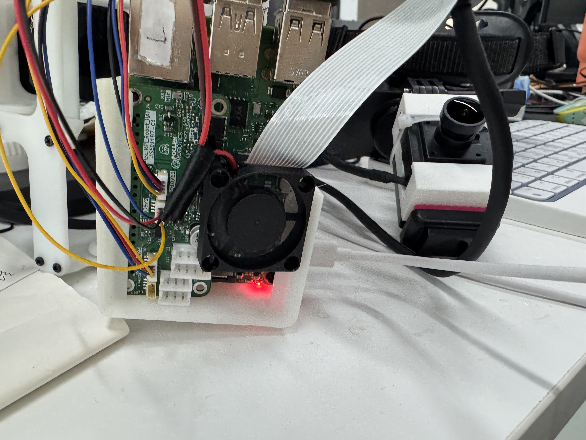
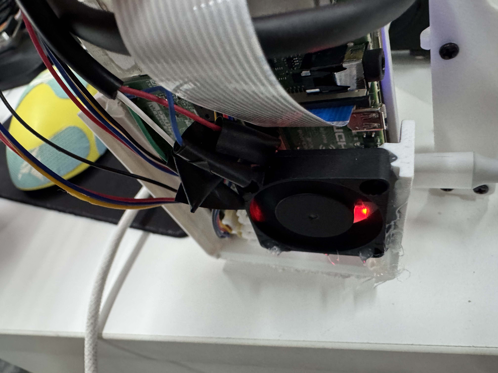

# Cooling a Grabette

A Grabette's Raspberry Pi shares a small space with the camera connections,
HAT and enclosure. Sustained recording and video processing can raise its
temperature enough to reduce the processing capacity available to capture.
An optional fan and heatsink can help maintain thermal headroom.

Raspberry Pi reduces clock frequencies as its temperature approaches the thermal
limit. Its [thermal-management documentation](https://www.raspberrypi.com/documentation/computers/raspberry-pi.html#frequency-management-and-thermal-control)
describes how cooling can reduce throttling. A cooler device can still lose
frames because of CPU, storage, USB or processing load, so check the recording
as well as the temperature.

## Example installation

The photographs show a contributor's Raspberry Pi 4 Grabette with an added
5 V fan. The contributor also fitted a copper heatsink. This is an example
retrofit, rather than a new required part or a replacement for the
[assembly guide](./build_your_own.md#assembly).





With power disconnected:

1. Fit a heatsink that clears the HAT, connectors and enclosure. Use a suitable
   thermal interface on the processor; keep the conductive copper and any
   fasteners away from exposed contacts and neighbouring components.
2. Secure the fan so that air can pass across the processor and heatsink and
   leave the enclosure. Keep the camera ribbon and loose wires clear of the
   blades and airflow. Check clearance through the gripper's full travel.
3. Use the fan's specified voltage and connector pinout. For a 5 V fan, use a
   suitable 5 V supply connection with enough current available alongside the
   cameras. Prefer a correctly terminated cable; do not infer polarity from
   wire colours. Raspberry Pi's [hardware documentation](https://www.raspberrypi.com/documentation/computers/raspberry-pi.html#40-pin-gpio-header)
   distinguishes 5 V power pins from 3.3 V GPIO signals: a fan motor must not be
   powered directly from a signal pin.

The photographs do not specify an electrical pinout or a tested fan model.
Check the fan label and the actual board/HAT connections before reproducing the
installation. This example does not require changes to Grabette's capture
software or firmware temperature limits.

## Check temperature and throttling

The dashboard's **Health** section displays the temperature. For a log that
also covers recording with the dashboard closed, run this on the Raspberry Pi:

```bash
while true; do
    date -Is
    vcgencmd measure_temp
    vcgencmd get_throttled
    cat /sys/devices/system/cpu/cpu0/cpufreq/scaling_cur_freq
    sleep 2
done | tee cooling.log
```

Stop the logger with **Ctrl+C**. The frequency value is in kHz. A lower clock
while idle can be normal frequency scaling; it does not by itself establish
thermal throttling.

Interpret `get_throttled` as a bitmask, using Raspberry Pi's
[command reference](https://www.raspberrypi.com/documentation/computers/os.html#get_throttled):

- Bits 0–3 describe current undervoltage, frequency capping, throttling and
  the soft temperature limit, respectively.
- Bits 16–19 record that the corresponding conditions have occurred. They can
  remain set after a condition clears; record the initial value before testing.
- `throttled=0x0` means none of those current or recorded flags are set. It does
  not certify frame continuity or successful saving.

Sample through idle, camera preparation, recording and the complete save.
Compare runs with the same camera configuration, frame rates, clip lengths,
power source, software and preview activity. Note ambient temperature and the
fan/heatsink arrangement. Do not disable thermal protection for the comparison.

## Observations from one contributor's build

These observations came from a Raspberry Pi 4 build using a CSI primary camera,
an OAK-D SR and an additional USB head camera. The capture and background-save
software had local modifications, so these figures are not a benchmark of the
default upstream configuration. The logger read
`/sys/class/thermal/thermal_zone0/temp` and checked firmware flags separately
with `vcgencmd get_throttled`.

On **29 October 2026**, with the fan installed and **before the copper heatsink
was fitted**, 795 samples over approximately 26.5 minutes measured temperatures
from 40.9 to 58.4 °C. This monitoring period included idle, roughly ten minutes
of continuous recording, additional recording activity and background saving.
No current or historical undervoltage or throttling flags were observed in
those samples.

That run did **not** pass a complete recording-and-save acceptance test: a
background finalizer exceeded its configured deadline. The temperature
observations therefore establish only what was measured thermally during the
run, not that every recording or saved file was valid.

A subsequent **30 October 2026** test, after the contributor reported fitting
the copper heatsink, recorded a maximum of 58.9 °C and no active throttling
flags. Its four recording cases were approximately 15 seconds each, alongside
offline encoding and file checks. Unrestricted concurrent encoding still
damaged capture continuity under CPU load. Pausing encoding during recording
preserved capture in that short test.

There was no controlled fan-only versus fan-and-heatsink comparison. These
measurements do not isolate the benefit of the copper heatsink, establish a
performance-improvement percentage, or demonstrate long-term stability.

## Confirm the actual collection workload

After installing cooling, use the tasks and clip lengths you intend to collect.
Wait for each episode to finish saving and inspect the service log for errors:

```bash
journalctl -u grabette.service --since "10 minutes ago" --no-pager
```

Check each saved video by decoding it, and compare its decoded frame count with
the corresponding timestamp sidecar. Inspect timestamp gaps and sensor sample
rates as well. Different cameras can have different start times and frame
counts; the useful check is each stream's own frame-to-timestamp association and
continuity. A playable file, a container's packet count or a cool processor
alone is insufficient.

If temperature and throttling are under control but data still degrades, check
CPU utilisation, storage wait, USB traffic and background encoding separately.
Cooling provides thermal headroom; scheduling and saving still need to fit the
available resources.
