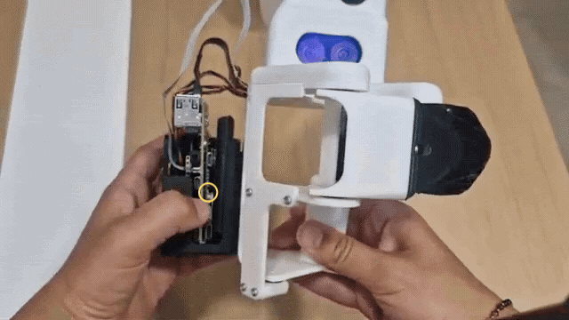

# Getting started

This page takes you from a Grabette in its box to its dashboard, ready to record.

<Tip>

Don't have a device yet? Grabette is open hardware: [Build your own](./build_your_own.md) page walks you through the parts, the assembly and the software install.

</Tip>

## Power

### Power on and off

To power on, press the button once, then press it a second time and hold it until the blue light appears. Give the device a moment to start up.



To power off, use the **Power off** button in the [dashboard](#dashboard)'s title bar, or the power button next to the device in the [Fleet Space](./data_collection.md#grabette-fleet).

### Charging

Plug a USB-C cable into the charging port shown below. The board has several USB-C ports that look alike: use this one.


The battery level is shown on the dashboard's **Overview** page and next to the device in the Fleet Space.

<!-- TODO: charge time, and what the battery indicator shows while charging. -->

## First-time setup with the Bluetooth tool

You use the [Bluetooth tool](https://pollen-robotics.github.io/grabette/) **once**, when you set up your Grabette: it connects to the device over Bluetooth to put it on your WiFi network. After that, you reach the Grabette over WiFi, through its dashboard.

Open it in Chrome or Edge, on a computer or an Android phone, and follow its steps:

1. **WiFi setup** — connect to the Grabette, scan for networks, pick yours and enter its password.
2. **Calibration** — open the gripper fully, start the calibration, then move the gripper: the 3D model should follow it. The Grabette won't record until it is calibrated.
3. **Dashboard** — the tool gives you the device's address.

Come back to it only to move the Grabette to another WiFi network.

<Tip warning={true}>

The tool doesn't work on iPhone or iPad, whatever the browser: every iOS browser runs on WebKit, which has no Web Bluetooth.

</Tip>

If the tool can't find or connect to the device, see the [FAQ](./faq.md#the-bluetooth-tool-wont-connect).

## Dashboard

Every Grabette serves a web dashboard on port **8000**. It is how you check the device, make a test recording, review episodes or switch wifi network — no SSH, no command line.

```
http://<hostname>.local:8000     # e.g. http://R-grabette.local:8000
```

The device's IP address works too.


### Overview

The landing page.

- **Speaker** — the volume of the recording beeps, a mute button, and **Test sounds** to play them. It says so when no speaker is fitted.
- **Cameras** — the live image, with an RGB / Depth toggle. Choosing Depth turns the depth camera on if it's off.
- **3D model** — the gripper, moving with the live finger-joint angles. Open and close it to check if the angle sensors are properly calibrated, and use **Recalibrate** under it if they aren't.
- **Device** — hostname, side (left or right hand), IP address and WiFi network, with a **Change network** shortcut.
- **Health** — battery, temperature and storage used.
- **Grabette data** — shortcuts to **Test Recording** and **Episodes**.
- **Account & fleet** — the Hugging Face sign-in, and the **Fleet Space** button to record data and create datasets.

### Signing in to Hugging Face

Click the Hugging Face button to sign in with your account (OAuth, one click). Pasting an access token is available as a fallback under *or use a token*; create one at [huggingface.co/settings/tokens](https://huggingface.co/settings/tokens) with write access to the datasets you intend to push.

The Fleet Space and every upload depend on this login.

### Test Recording

A guided first recording, to check the whole device before a real session:

1. **Record a few seconds** — press the button and wait for the start signal (a rising beep, and the LED stops blinking), pick an object up, then press again and wait for the stop signal (the last beep, and the LED turns off). The page shows whether each camera is connected, and tells you when to press.
2. **Check what was recorded** — a summary, a replay of the RGB and depth video with the angle chart, and a download link.
3. **Delete it** — a test recording is not training data. If you keep it, it is filed under the *Unassigned* task in **Episodes**.
4. **Record real data** — sign in to Hugging Face if needed, and open the Fleet Space.


### Episodes

Where you review what is on the device.

- **Tasks** — pick a task to list its episodes. Tasks are created in the Fleet Space, not here.
- **Episodes table** — duration, frame count, angles and status for each episode.
- **Replay** — the video with the angle chart and a timeline.
- **Check** — a full verdict on the episode's files and quality. Deleting a bad take now is much cheaper than discovering it after SLAM.
- **Download** — the episode as an archive.
- **Delete**, and **Delete all Grabette data** at the bottom of the page.


### Network

The device card again, and **Change WiFi network** to see the current connection and switch networks. The [Bluetooth tool](https://pollen-robotics.github.io/grabette/?device=grabette#wifi) is the fallback when the device isn't reachable at all.

## Ready to record your first dataset?

Sign in to Hugging Face, then hop on to the [Fleet Space](./data_collection.md) 🚀
